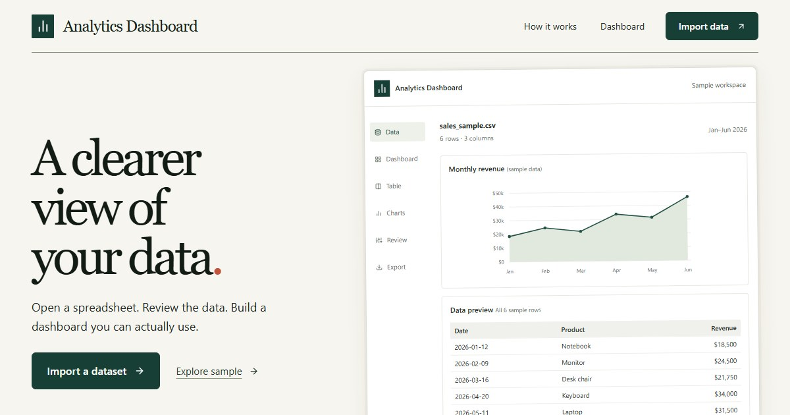

# Analytics Dashboard

**Explore, clean, and explain your data in your own browser.** Analytics Dashboard is an open-source workspace for importing files, reviewing data quality, building charts, and asking questions backed by your data. The default edition runs without an account, API, or database.



[Get started](#get-started) · [Explore the project](#explore-the-project) · [Contribute](#contribute) · [Documentation](#documentation) · [License](#license)

## What you can do

| Capability | How it works |
| --- | --- |
| Import and review | Open CSV, TSV, TXT, XLSX, or XLS files, including whole folders and multi-sheet workbooks. Review types, missing values, and cleaning choices before analysis. |
| Explore and present | Use tables, charts, Smart Layout suggestions, reports, and exports. Layout and chart changes are reviewable. |
| Ask about your data | Use local calculations and evidence search over approved data. Optional semantic search downloads a model only when requested. |
| Keep your work | Save datasets and layouts in the browser, download workspace backups, and restore them later. Encrypted backup is available for downloaded archives. |

The default edition keeps imported files, working rows, and questions in browser storage. Explicit URL imports contact the chosen source, and optional model downloads contact their asset hosts. Your browser profile and site origin own the workspace, so [make a backup](docs/application-features.md#storage-and-recovery) before clearing site data or changing domains.

> **Assistant status:** Experimental local LLM generation is disabled in release builds. A separate experimental build can run a real browser-local model to select validated data tools; the application calculates the answers. The [measured results and open quality checks](docs/assistant-status.md) explain what has and has not been verified.

## Get started

You need Node.js **22.13 or later in the Node 22 line** and npm **10 or later**. From the repository root:

```sh
npm run install:frontend
npm run dev
```

Open **http://localhost:5173**. Choose **Upload Dataset**, import a file or folder, review its data quality, select **Approve Data**, and open the dashboard. No backend setup is needed for this path.

For a local production build of the browser edition:

```sh
npm --prefix frontend run build:release
npm --prefix frontend run preview
```

The separately enabled FastAPI edition uses MySQL and requires Redis for shared rate limiting in production. It has different data and security requirements. Start with the [architecture](docs/architecture.md) and [development guide](docs/development.md) before working on it. The root `dev.bat` and server Compose files belong to that edition; the browser-only container is `docker-compose.personal.yml`.

## Explore the project

| Location | What lives there |
| --- | --- |
| [`frontend/`](frontend/) | React application, browser data engine, workers, charts, and frontend tests |
| [`backend/`](backend/) | Separate FastAPI edition, persistence, analytics, and backend tests |
| [`docs/`](docs/) | Product, architecture, security, development, and deployment guides |
| [`.github/workflows/`](.github/workflows/) | Automated application, browser, and container checks |

The frontend uses React 18, Vite, Tailwind CSS, and Recharts, with Plotly loaded for advanced chart types. The optional backend uses FastAPI, SQLAlchemy, Pandas, NumPy, SciPy, and scikit-learn. Read the [frontend module boundaries](docs/frontend-module-boundaries.md) before changing storage or dashboard state, and the [shared analytics contracts](docs/analytics-contracts.md) before changing calculations.

## Contribute

Contributions to accessibility, data import and recovery, performance on weaker devices, tests, documentation, and clear data explanations are welcome. A useful contribution starts with a reproducible case and stays within one behavior or area of the codebase.

1. Check the relevant [feature limits](docs/application-features.md), [design](docs/design.md), and [security boundaries](docs/security.md). For a larger change, describe the user problem and proposed behavior in an issue first.
2. Create a branch and make a focused change. Add a test when it protects behavior or a past failure; include screenshots or a short recording for visible UI changes.
3. Run the frontend gate before opening a pull request:

   ```sh
   npm --prefix frontend run check
   ```

4. In the pull request, explain the change, how you checked it, and any limitation that remains. For backend changes, also run the backend test suite described in the [development guide](docs/development.md).

Use synthetic or public fixtures in contributions. Keep real credentials, private datasets, browser profiles, model caches, and raw audit artifacts out of commits. Do not put sensitive vulnerability details in a public issue; contact a maintainer privately.

## Documentation

The [documentation index](docs/README.md) is the best starting point. These guides cover the main contributor questions:

- [Features, storage, and limits](docs/application-features.md)
- [Architecture](docs/architecture.md) and [development setup](docs/development.md)
- [Browser-local assistant](docs/browser-local-ai.md) and [measured assistant status](docs/assistant-status.md)
- [Security model](docs/security.md) and [public launch checks](docs/launch-actions.md)
- [Personal hosting](docs/personal-hosting.md) and [separate server deployment](docs/deployment.md)

The personal edition and experimental assistant have different acceptance gates. Physical-device, hosted-origin, and fresh chatbot holdout checks remain open; see the [launch checks](docs/launch-actions.md) and [assistant status](docs/assistant-status.md) before making release claims.

## License

Released under the [MIT License](LICENSE). Third-party components and distribution notes are listed in [THIRD_PARTY_NOTICES.md](THIRD_PARTY_NOTICES.md).
